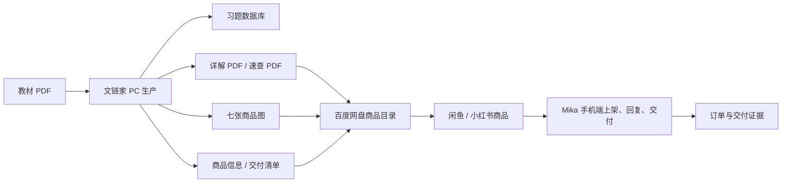
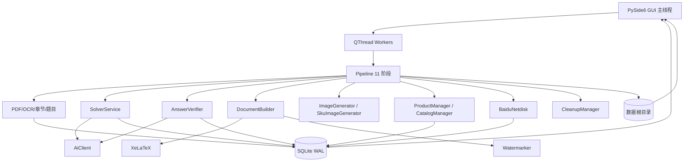
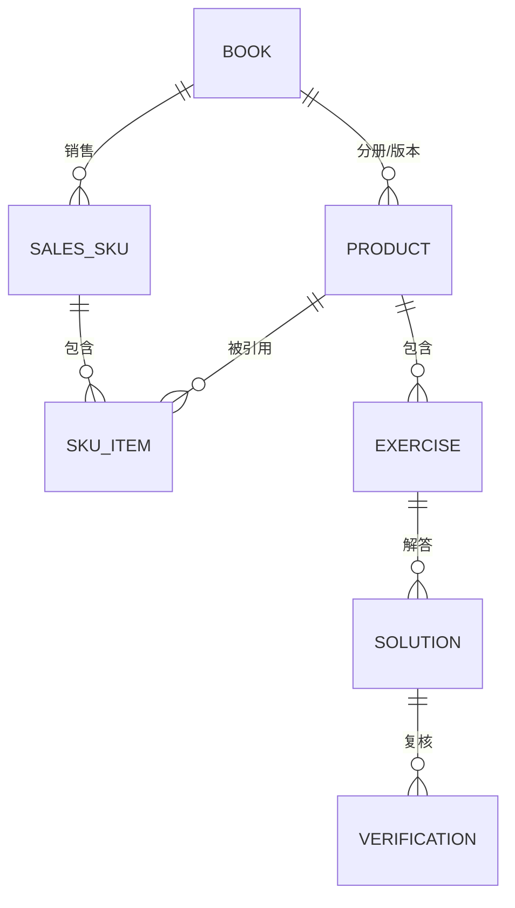

# 文链家 WenLianJia — 项目总览与架构说明

> 版本：v1.1.0  
> 日期：2026-11-10  
> 仓库根目录：`D:\Workspaces\goods\WenLianJia`  
> 说明：本文是项目级总览，面向维护者、验收者和后续接手人；细节规范见
> `README.md`、`docs/ARCHITECTURE.md`、`docs/TEST_REPORT.md` 和
> `docs/KNOWN_ISSUES.md`。

## 1. 项目目的

文链家是一套运行在 Windows 上的**教材习题解析数字商品生产工具**。它把一本
教材 PDF（文字版或扫描版）转化为可复核、可排版、可交付、可追溯的习题详解
商品，而不是简单地把教材扫描件重新打包出售。

核心目的有五个：

1. **把非结构化的教材内容变成结构化的题目数据。**  
   识别章节、题目边界、题型、页码和题图，形成可逐题检查的数据库。

2. **把“AI 生成”变成“可验证的答案生产”。**  
   每题先由主模型生成结构化解析，再由独立复核模型先独立作答、再对账；结构
   检查、算术检查、低相似度提示和人工复核共同决定题目状态。

3. **把答案变成可销售的商品。**  
   生成 A4 中文详解 PDF、答案速查 PDF、逐页水印、七张商品图、商品介绍、
   文件清单和交付记录；支持单册、上下册、自定义分册和套装 SKU。

4. **把交付变成可验证的闭环。**  
   本地文件先计算 SHA-256；百度网盘上传后核对远端大小，可选下载回读
   SHA-256；分享链接和人工核验分开记录；不把“上传成功”当成“买家可访问”。

5. **把风险留在可见处。**  
   不伪造 AI 调用、不伪造封面、不伪造上传/分享、不把模型自信当成正确；
   版权、封面授权、教材版本和真实买家访问都需要人工确认。

### 1.1 它不做什么

- 不复制、重排或出售教材原文；商品是**原创习题解答**。
- 不把 AI 自动复核通过宣传为“数学上绝对正确”。
- 不替用户判断教材封面是否拥有商业使用权。
- 不在没有百度网盘授权时伪造分享链接。
- 不删除唯一一份原始教材；清理必须经过两阶段和人工确认。

## 2. 在 Goods / Mika 业务中的位置

文链家不是孤立的工具，而是“商品生产 → 上架 → 交付”链路中的**PC 生产端**。



边界：

- **文链家**负责解析、解题、复核、排版、商品资料、云端文件和验收记录。
- **Mika / Goods**负责手机端的上架、私信、订单和平台操作；手机账本对手机侧
  资产拥有最终权威。
- 两端通过文件、商品 JSON、网盘目录和验收记录交接；不共享进程内状态。
- 电脑端不代替手机端写手机账本，手机端也不修改 PC 生产数据库。

## 3. 仓库组织

```text
WenLianJia/
├─ main.py                     PySide6 应用入口
├─ core/                       领域逻辑与基础设施
│  ├─ pdf_parser.py            文本层/扫描页解析、截图、嵌图
│  ├─ ocr_engine.py            RapidOCR，PaddleOCR 可选适配
│  ├─ layout_analyzer.py       字号/标题/版式分析
│  ├─ chapter_detector.py      目录优先、标题回退、全书回退
│  ├─ exercise_detector.py     习题区/编号起点/边界/题型
│  ├─ ai_client.py             OpenAI Responses/Chat 兼容客户端
│  ├─ ai_solver.py             逐题结构化解答
│  ├─ answer_verifier.py       独立作答 + 对账复核
│  ├─ quality_control.py       结构/占位符/算术/相似度检查
│  ├─ document_builder.py      XeLaTeX 详解/速查 PDF
│  ├─ latex_utils.py           LaTeX 转义、富文本块、公式保留
│  ├─ watermark.py             Pillow 生成 + PyMuPDF 逐页叠加
│  ├─ image_generator.py       七张商品图（生产实体）
│  ├─ sku_image_generator.py   七张商品图（SKU/套装）
│  ├─ product_manager.py       商品信息、文件清单、验收记录
│  ├─ catalog.py               Book / Product / SalesSKU 三层目录
│  ├─ book_lookup.py           书目身份识别、DeepSeek 检索、封面校验
│  ├─ baidu_netdisk.py         OAuth、分块上传、校验、分享
│  ├─ cleanup_manager.py       两阶段清理
│  ├─ pipeline.py              11 阶段流水线、断点、暂停/取消
│  ├─ db.py                    SQLite WAL 与迁移
│  ├─ paths.py                 数据根与目录契约
│  ├─ config.py                设置默认值与深合并
│  ├─ secrets.py               Windows DPAPI 密钥存储
│  ├─ logging_setup.py         轮转日志与脱敏
│  ├─ prompts.py               Prompt 模板加载
│  └─ library/                 商品中心/万级商品库（SQLAlchemy 2.0）
├─ gui/                        七个页面、主题、Worker、目录弹窗
├─ models/schemas.py           Pydantic 记录与枚举
├─ prompts/                    数学/科学/复核/证明/图片提示词
├─ templates/latex/            ctexbook 详解与速查模板
├─ tests/                      pytest、夹具、两册烟测
├─ scripts/                    安装、启动、初始化、doctor、发布
├─ docs/                       架构、配置、百度、测试、已知问题、商品库
├─ samples/                    流程、两册套装、真实 AI 三类样张
├─ release/                    构建产物与本目录校验文件
└─ WenLianJia_Data/            运行数据（不入库、不随发布包分发）
```

### 3.1 哪些内容应进入版本库

应该进入：

- `core/`、`gui/`、`models/`、`prompts/`、`templates/`、`tests/`、`scripts/`
- `docs/`、`README.md`、`PROJECT-OVERVIEW.md`
- `samples/` 中明确标注来源的测试样张
- `requirements.txt`、`.env.example`、`pytest.ini`、`.gitignore`

不应进入：

- `.venv/`、`WenLianJia_Data/`、`*.db`、`secrets.bin`、`settings.json`
- 日志、缓存、`.tmp_*`、`acceptance/` 运行现场
- 用户教材原件、未授权封面、买家/订单信息
- `release/*.zip` 可以放 GitHub Release，不必塞进 Git 历史

## 4. 整体架构



分层：

| 层 | 职责 | 关键约束 |
| --- | --- | --- |
| 表现层 `gui/` | 六/七个页面、目录弹窗、进度、日志 | 不阻塞 UI；长任务进 Worker |
| 编排层 `core/pipeline.py` | 阶段顺序、断点、暂停/取消、错误归集 | 阶段可恢复；不把未完成当完成 |
| 领域服务 | 解析、解题、复核、排版、商品、云盘 | 每个服务可单独测试 |
| 基础设施 | SQLite、文件路径、DPAPI、日志、HTTP | 密钥不落明文；路径可审计 |
| 外部服务 | OpenAI、DeepSeek、百度网盘 | 没有凭据就明确“未配置”，不模拟成功 |

## 5. 生产流水线

`Pipeline` 的 11 个阶段：

| 阶段 | 输入 | 输出 | 失败/恢复行为 |
| --- | --- | --- | --- |
| `parse` | 教材 PDF | 页文本、截图、嵌图、页记录 | 加密/损坏明确报错；已解析页可复用 |
| `chapters` | 页面、目录、标题 | 章节及页码范围 | 目录优先；回退标题/全书 |
| `exercises` | 章节、页面、编号 | 逐题记录、每章计数 | 低置信度保留标记；人工可检查 |
| `solve` | 题目、题图 | 结构化解答 `AI_DRAFT` | 单题失败不拖垮整本；重试/人工 |
| `verify` | 解答 | 复核记录与状态 | 独立作答 + 对账；高风险转人工 |
| `pdf` | 已复核解答 | 详解/速查 PDF | 严格模式拒绝缺答案；可重建 |
| `images` | 真实 PDF、统计 | 七张 1080×1440 PNG | 本地确定性设计，不依赖图片模型 |
| `records` | PDF、图片、统计 | 商品 JSON/MD、清单、验收 | 云端项先 `pending` |
| `upload` | 交付文件 | 远端文件、上传记录 | 未配置/未授权跳过并说明 |
| `share` | 商品目录 | 分享记录 | 付费权限错误转 `needs_manual` |
| `cleanup` | 验收状态 | 暂存清理清单 | 只暂存，不自动永久删除 |

进度以 `jobs.stage_status` 持久化；暂停/取消通过 `PipelineControl` 事件检查；
已完成阶段可跳过；PDF 构建失败会保留构建日志与中间文件。

## 6. 核心数据模型

### 6.1 三层业务对象



- **Book（教材实体）**：书名、原文书名、作者、译者、出版社、版次、年份、
  ISBN-10/13、册数、语言、学科、封面来源/授权、核验状态。
- **Product（生产实体）**：某一册的解析、答案、PDF 和商品包；一个
  Book 可以有多个 Product。
- **SalesSKU（销售实体）**：真正上架的单个商品；`kind=single|bundle`，
  单品引用一个 Product，套装引用多个 Product（通过 `SkuItem`），只保存
  文件引用，不复制 PDF，也不重复调用 AI。

金额一律用**整数分**存储；人民币输入用 `Decimal` 四舍五入到分。套装原价
默认等于各分册原价之和；超过基准价必须显式 `allow_above_parts`。

### 6.2 SQLite 表组

共 28 张表，主要分为：

- 生产：`products`、`jobs`、`pdf_pages`、`chapters`、`exercises`、
  `solutions`、`verifications`、`generated_files`
- 商品：`books`、`skus`、`book_cache`、`product_families`、`book_versions`、
  `categories`、`tags`、`entity_tags`、`assets`、`asset_links`
- 交付：`uploads`、`shares`
- 运营：`batch_jobs`、`batch_job_items`、`audit_log`
- 支撑：`api_usage`、`logs`、`settings`、`perf_notes`、`library_migrations`

SQLite 采用 WAL；线程使用独立连接。旧库通过增量迁移补列/建表，迁移记录在
`library_migrations`，不会静默重建数据库。

## 7. 关键实现方式

### 7.1 PDF 解析与 OCR

- `PdfParser` 先读取文本层；按文本量、图片覆盖率和页类型判断是否扫描页。
- 扫描页默认 RapidOCR；PaddleOCR 是可选适配器，当前验证环境未安装。
- 每页保留 JPEG 截图；公式读不出来时保留截图，**不猜公式**。
- 输出 `document.json`、`pages.jsonl`、`lines.jsonl` 和页面图片，供审计与重建。
- 真实扫描页测试：统计学习方法第 36 页，RapidOCR 返回 32 行，未编造文本。

### 7.2 章节与题目检测

- 章节：PDF 目录优先；无目录时按字号/标题模式；再回退到全书一章。
- 题目：识别“习题/练习/复习题”等区段，再按编号起点切分；遇到“本章小结”
  等泛化标题会终止题目块，避免把总结并入最后一题。
- 结果包含题号、页码、题型、置信度、题图、章节计数；低置信度不丢弃，
  交给人工复核页处理。

### 7.3 解题

- `SolverService` 按数学/科学选择提示词，要求严格 JSON：
  考点分析、核心知识点、解题思路、详细步骤、最终答案、方法总结、易错点。
- 扫描题/含图题最多附带 2 张页面图；保留原始题图路径。
- 写入 `AI_DRAFT`；绝不把模型输出直接标记为“正确”。

### 7.4 独立复核

两阶段：

1. 复核模型**不看候选答案**，先独立作答并给出关键检查。
2. 再拿独立答案与候选答案对账，输出 `pass`/`needs_revision`/`reject`/
   `inconclusive`、问题清单、检查项和置信度。

`VERIFIED` 的条件：对账 `pass`、无硬性结构失败、无 high/blocker 问题、
未触发升级模型。其他情况一律 `NEEDS_REVIEW`。复核失败会记录
`INCONCLUSIVE` 记录，不伪装成通过。

真实验收中，Q4 最终答案正确但矩阵行变换抄错，复核正确判为
`NEEDS_REVIEW`，说明该层不是形式主义。

### 7.5 PDF 与排版

- Jinja2 生成 `ctexbook`；A4、22mm 页边距、目录、页眉页脚、公式、图片、
  longtable、needspace、hyperref。
- 中文使用 Microsoft YaHei/SimSun/SimHei；拉丁正文使用 Cambria，避免 α、≠
  等字符落入 Latin Modern 而缺字。
- 题干开头的编号会被剥离，题号由模板统一生成；正文中连续 `-`/`*` 行转
  itemize，数字行转 enumerate，`$$...$$`/`\[...\]` 保留为公式。
- xelatex 运行两次；检查页数、中文字符数、替换字形、缺字和 overfull box。
- 水印由 Pillow 以真实中文字体生成透明 PNG，PyMuPDF 逐页叠加；默认
  “全网同名爱做题的大肥鱼”，35°，18%，浅灰，居中。

### 7.6 商品图

- 生产实体七张图：封面、主图、内容展示、详情、特色、文件说明、品牌；
- SKU/套装七张图：真实封面（仅在有授权来源时）、分册页卡、套装价/原价/省、
  真实 PDF 页预览、真实章节/题数；
- 没有可靠原版封面时，明确标注“自主设计视觉封面，非出版社原版封面”；
- 不使用 AI 生成图片伪造教材封面；文字、价格、统计由程序排版。

### 7.7 书目检索与封面

- `extract_identity` 从 PDF 元数据、ISBN、书名页启发式提取身份线索；
- `DeepSeekTools` 使用官方 `/v1/tools/search` 与 `/v1/tools/fetch`，独立
  `DEEPSEEK_API_KEY`，按成功请求千次计费，价格可配置；
- 搜索结果先缓存；候选按 ISBN、作者、出版社、版次、权威度排序；
- 只有唯一强匹配才自动 `VERIFIED`；多版本/来源不明 → `NEEDS_REVIEW`；
- 封面下载校验 content-type、大小、尺寸，记录来源 URL、来源名称和授权说明；
- 没有来源时允许自主设计，但绝不冒充出版社封面。

### 7.8 百度网盘

- OAuth 授权码 + refresh token；token 存 DPAPI，不进日志；
- 官方上传限制在 `/apps/{appname}` 下；客户端明确暴露该限制；
- 上传流程：precreate → locateupload 上传域名 → 4MB 分块 superfile2 →
  create；校验每块 MD5 和远端大小；
- 列目录的 `md5` 是云端哈希，不等于本地 MD5；可选用 dlink 下载回读
  SHA-256；
- 分享接口是付费接口；无权限时标记 `needs_manual`，不伪造链接；
- SKU 上传会创建 `01_习题详解`、`02_商品图片`、`03_商品信息` 并回读校验。

### 7.9 清理

`evaluate → stage → restore/purge` 两阶段：

- 需要交付清单、本地哈希、验收通过、所有交付文件云端已验证、分享已验证、
  且开启下载哈希；
- 只暂存中间目录，不删除最终 PDF、商品图、交付记录和唯一源教材；
- 永久删除必须输入精确字符串“确认删除”；
- 暂存清单可恢复。

### 7.10 GUI

七个页面：

1. 工作台：统计、最近任务、快捷入口、配置摘要。
2. 新建商品：PDF 检查、书目/学科/版本表单、上传/分享/清理选项。
3. 生产监控：阶段进度、暂停/恢复/取消、日志尾部。
4. 习题复核：逐题编辑、保存、人工通过、重解/重复核。
5. 商品管理：商品包、云端续跑、书目与销售 SKU 弹窗。
6. 商品中心：系列模板、四级目录、SKU 生命周期、批量改价、资产、
   备份恢复、CSV/XLSX（第 26 章并行模块）。
7. 设置：模型、价格、DeepSeek、水印、LaTeX、百度 OAuth、数据/日志。

长任务全部进 `QThread`；关闭窗口时先请求取消并等待，避免后台写库。

## 8. 数据与目录布局

```text
WenLianJia_Data/
├─ 00_待处理/
├─ 01_生产中/<SKU>_<书名>/
│  ├─ 00_原始教材/
│  ├─ 01_教材解析/
│  ├─ 02_习题数据库/
│  ├─ 03_AI答案与详解/
│  ├─ 04_最终PDF/
│  ├─ 05_商品图片/
│  ├─ 06_商品信息/
│  └─ 07_交付记录/
├─ 02_已完成/
│  ├─ 00_书目/<book_code>/
│  └─ 01_销售商品/<sku_code>/
│     ├─ 01_商品图片/
│     ├─ 02_商品信息/
│     └─ 03_交付记录/
└─ 03_系统配置/
   ├─ settings.json
   ├─ wenlianjia.db
   └─ secrets.bin
```

数据库是状态权威；目录是交付物载体。商品包的 `06_商品信息`、
`07_交付记录` 与 SKU 的 `02_商品信息`、`03_交付记录` 是验收依据。

## 9. 安全、质量与合规

### 9.1 安全

- API Key/OAuth token 使用 Windows DPAPI 加密；`settings.json` 不保存明文。
- 日志过滤器脱敏 `sk-`、`Bearer`、access/refresh token 和常见密钥字段。
- 发布包不含 `.venv`、数据库、日志、密钥、缓存。
- 百度 token 不进入 URL 日志；错误信息保留 errno，但不泄露凭据。
- 外部账号操作只使用用户明确授权的账号和路径。

### 9.2 质量

- 42 个 pytest（含单元、集成、GUI、商品库）；
- 结构检查：答案非空、最少步骤、占位符、长度、数值等式；
- 复核模型独立作答，避免“自己证明自己”；
- PDF 构建后做页数/中文字符/缺字/overfull 检查；
- 真实 AI 验收保留一个 `NEEDS_REVIEW` 案例，不追求“全绿”假象。

### 9.3 版权与平台

- 商品是原创解答，不包含教材正文；
- 原版封面只用于识别版本；商业使用授权未确认时使用明确标注的自设计封面；
- 平台规则、教材版本识别、买家访问权限由 owner 最终确认；
- 文件哈希相同不等于数学正确或拥有转售权。

## 10. 当前验证状态

| 项目 | 状态 | 证据 |
| --- | --- | --- |
| 合成教材解析 | 通过 | 5 页、2 章、8 题、0 低置信度 |
| 生产流水线 | 通过 | 8/8 复核、12 页详解、2 页速查、7 图、9 个哈希文件 |
| 两册/套装 | 通过 | Book LA001，单册 ¥3.99，套装 ¥5.00/¥7.98，复用 PDF |
| 真实 OpenAI | 通过（合成书） | 24 次调用、7 VERIFIED、1 NEEDS_REVIEW、0 失败 |
| OCR | 通过（真实扫描页） | 32 行、6.74 秒、无编造 |
| GUI | 通过 | 七页、目录弹窗、设置保存、可见桌面启动 |
| 自动测试 | 通过 | `42 passed` |
| 发布包 | 通过 | 7,724,531 字节、156 条目、SHA-256 `84407A41…DD2FC` |
| DeepSeek 真实检索 | 未验证 | 无 Key |
| 百度真实上传/分享 | 未验证 | 无 AppKey/Secret/分享权限 |
| 真实出版社封面 | 未验证 | 无授权来源 |
| 真实教材人工复核 | 未验证 | 需授权教材与人工 |

## 11. 已知边界

1. 真实 `gpt-4.1` 只跑过合成书；真实教材的 OCR、长证明、公式和版式仍需验收。
2. 未配置模型价格，真实调用费用记为未知，不能拿 0 当真实成本。
3. DeepSeek 检索/封面下载只有 fake provider 测试，没有真实结果。
4. 百度上传/SKU 上传/分享只有 fake client 与本地路径测试，没有真实账号验证。
5. 扫码页公式不重建 LaTeX，只保留页面截图；复杂公式需人工。
6. `VERIFIED` 是独立模型复核 + 结构检查，不是形式化证明。
7. 长题可能跨页；这是排版优化项，不是数据丢失。
8. 章/PDF 级重试没有独立按钮，当前靠任务恢复和逐题重试。
9. 无签名安装器，依赖 Python、TeX Live 和中文字体。
10. 商品中心第 26 章是并行模块，需与主教辅流程分别验收。

## 12. 运行、测试与发布

```powershell
# 安装（已有 .venv 会复用）
powershell -ExecutionPolicy Bypass -File .\scripts\install.ps1

# 启动
powershell -ExecutionPolicy Bypass -File .\scripts\start.ps1

# 初始化数据库 / 环境诊断
.\.venv\Scripts\python.exe .\scripts\init_db.py
.\.venv\Scripts\python.exe .\scripts\doctor.py

# 全量测试
$env:PYTHONUTF8=1
.\.venv\Scripts\python.exe -m pytest -q

# 构建发布包
powershell -ExecutionPolicy Bypass -File .\scripts\build_release.ps1
```

发布包校验：

```text
release/WenLianJia_v1.1.0.zip
7,724,531 bytes
SHA-256 84407A41D3816DBA49C9434B774913F289E73A0414EE899BABAE6972AF6DD2FC
```

## 13. 远端仓库发布约定

> 当前发布位置：`justinzyc271828-sys/Mika` 仓库的 `WenLianJia/` 子目录。
> 由于账号下没有独立的 Good/商品 仓库，经 owner 确认后作为 Mika 的配套
> 桌面工具发布，而不是覆盖 Mika 的 Android 工程。不要把运行数据、密钥或
> 手机运营证据混入源码仓库。

建议仓库内容：

- 本文与 `README.md`、`docs/`、`samples/`；
- `core/`、`gui/`、`models/`、`prompts/`、`templates/`、`tests/`、`scripts/`；
- `requirements.txt`、`.env.example`、`pytest.ini`、`.gitignore`。

不要提交：

- `.venv/`、`WenLianJia_Data/`、`*.db`、`*.bin`、日志、缓存；
- `acceptance/` 运行现场（可单独归档，不入源码库）；
- 用户教材原件、未授权封面、买家信息；
- 含真实 Key 的任何文件或终端记录。

发布前检查：

```powershell
git status --short
git diff --cached --stat
# 确认没有 .venv / 数据 / 密钥 / 日志
```

---

**一句话总结：** 文链家把“教材 PDF → 结构化题目 → 可复核答案 → 可交付商品”
串成一条可恢复、可审计、可人工兜底的 Windows 生产流水线；它解决的是效率
和一致性问题，不替代教师、审校者或版权判断。
