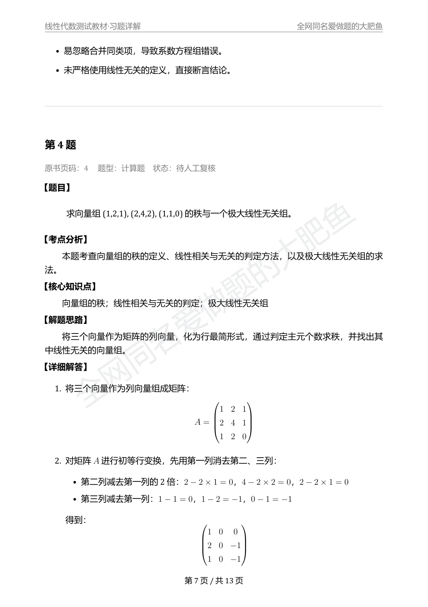

# 真实 OpenAI 调用测试样张

这不是出版社教材，也不是可售商品。它是一份**合成线性代数练习册**，用于验证文链家的真实 OpenAI 解题与复核链路。

## 本次实际调用

- 主模型：`gpt-4.1`
- 复核模型：`gpt-4.1`，使用独立提示词先独立作答，再与候选答案对账
- 题目：8 道短题（第 1 章 5 道，第 2 章 3 道）
- 调用次数：24 次（含结构化输出重试与复核）
- Token：输入 24,477，输出 11,616
- 费用：未显示金额。测试环境没有配置该模型的输入/输出单价，系统按诚实原则记为“费用未知”，没有猜测金额。

## 结果

| 状态 | 数量 |
| --- | --- |
| 自动复核通过 `VERIFIED` | 7 |
| 待人工复核 `NEEDS_REVIEW` | 1 |
| 失败 | 0 |

第 4 题被独立复核发现：候选答案的**最终结论正确**，但矩阵初等行变换中抄错/算错了矩阵元素，复核员因此判为 `NEEDS_REVIEW`。这是复核机制实际生效的证据，不是伪造的成功。

## 文件

- `01_最终PDF/REAL01_线性代数测试教材_习题详解_v1.0.pdf`：13 页完整详解，带逐页水印
- `01_最终PDF/REAL01_线性代数测试教材_答案速查版_v1.0.pdf`：3 页答案速查
- `02_商品图片/`：7 张商品图，基于本次真实 PDF 渲染
- `03_商品信息/`：商品信息、交付清单、验收记录
- `04_复核问题示例-Q4.png`：第 4 题排版与复核状态截图

## 边界说明

- 教材与题目为合成内容，不是真实出版物；不得作为真实教材商品出售。
- 8 道题全部由真实 OpenAI API 生成，不是固定样例。
- 自动复核通过不等于数学上绝对正确；仍需人工抽查，尤其是证明题和长推导。
- 未执行百度网盘上传、分享或清理；这些外部动作需要账号授权。
- 本样张不含 API Key、DPAPI 密钥或任何账户凭据。
